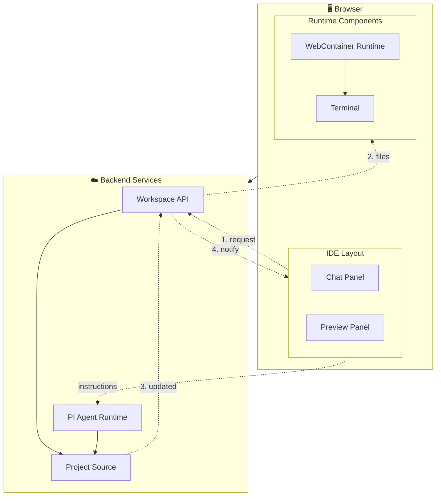
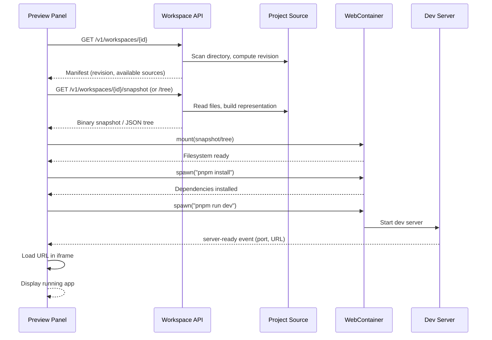
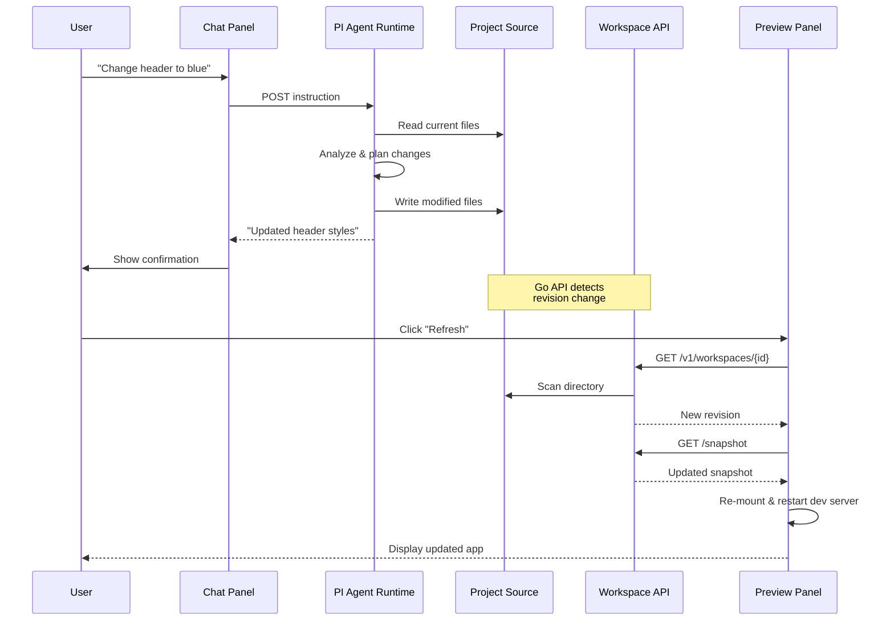

# PI Agent Web IDE

Browser-based IDE with a coding agent (PI) on the left and a live WebContainer preview on the right.

## 中文界面与字体

平台仅面向中文用户，不配置多语言路由、语言切换或国际化依赖。
首页、工作区、聊天、编辑器、预览及登录提示使用简体中文；代码、文件名、用户内容、
终端进程输出和必要的技术名称保持原样。

字体统一在 `app/globals.css` 的 `:root` 中配置：
- `--font-chinese-ui`：中文界面字体，优先使用系统已安装的苹方、微软雅黑等。
- `--font-code`：代码与终端的等宽字体及中文回退字体。

不下载远程中文字体。Monaco 编辑器的官方中文语言包和相关资源由
`scripts/prepare-monaco.mjs` 从本机依赖复制到 `public/monaco`，随 `dev` / `build`
自动准备，按需从本站加载，不使用 CDN。生成目录已忽略；若其中混入手动修改或陌生文件，
脚本会拒绝覆盖，请先检查内容，不要直接删除。

## 将本地密钥写入 Kubernetes

先准备好项目 `.env.local` 中的 `PI_LITELLM_BASE_URL`、`PI_LITELLM_API_KEY`、
`AUTH_CLIENT_SECRET`、`AUTH_SESSION_KEY` 四个变量，再执行：

```bash
# 只做服务端校验，不写入 Secret
node scripts/sync-k8s-secret.mjs --context default --dry-run
# 首次创建 agents/webcontainer-env
node scripts/sync-k8s-secret.mjs --context default
# 后续仅更新这四个变量，保留 Secret 内的其他字段
node scripts/sync-k8s-secret.mjs --context default --update
```

脚本使用 Node.js 22 的环境文件解析能力，仅读取指定文件中的白名单变量，
不会继承同名进程环境变量、上传整个 `.env.local`、打印密钥值或生成含密钥的 YAML。
默认使用当前 context，可显式指定 `--context`、`--namespace`、`--name`、`--env-file`。
目标 Secret 已存在时，必须显式传入 `--update`；更新采用带 resourceVersion 的合并补丁。
macOS / Linux 环境需要事先安装并配置 kubectl。请先确认 context 是预期集群。

首次缺少 Secret 的 Pod 会在创建 Secret 后自动重试启动。更新已有运行中 Pod 的环境变量后，
需要手动重启并等待就绪：

```bash
kubectl -n agents rollout restart deployment/webcontainer
kubectl -n agents rollout status deployment/webcontainer
```

仅在本机访问集群 Service：先确认并停止占用本机 3000 端口的应用，不要关闭整个 Docker 服务。

```bash
kubectl -n agents port-forward --address localhost svc/webcontainer 3000:3000
# 打开 http://localhost:3000/（同时监听 IPv4 和 IPv6 回环地址）
```

保持端口转发进程运行。它不会创建公网入口，也不会改变生产环境的 Authing HTTPS 回调。

## Authing single sign-on

The app uses OIDC authorization code + PKCE S256, state and nonce. ID tokens
are validated against the issuer's JWKS with **RS256**. Configure this signing
algorithm in the Authing application. Access tokens and client secrets remain
server-side; the encrypted ID token is used only as the standard `id_token_hint`
when redirecting to Authing logout. No tokens are stored in browser localStorage.
Browser sessions use Secure, HttpOnly, SameSite=Lax cookies. Sessions are
revocable, persist in SQLite, and expire at the earlier of eight hours or ID-token
expiry. Refresh tokens are not requested; sign in again after expiry.

Configure these exact URLs in Authing:

| Setting | URL |
| --- | --- |
| Login callback | `https://console.vibe-coding.host/auth/callback` |
| Logout callback | `https://console.vibe-coding.host/` |
| Login initiation | `https://console.vibe-coding.host/auth/login` |

Set `AUTH_ORIGIN`, `AUTH_ISSUER`, and `AUTH_CLIENT_ID` as shown in `.env.example`.
Set `AUTH_CLIENT_SECRET` and `AUTH_SESSION_KEY` only in the server environment
(or the existing `agents/webcontainer-env` Kubernetes Secret). Generate the latter
with `openssl rand -hex 32`. Never bake secrets into Docker build arguments or
client bundles. Rotate any secret disclosed in chat or logs. Keep the session key
stable across restarts; changing it prevents provider logout for old sessions.

The registered HTTPS origin must reach the application through a trusted ingress
or equivalent TLS endpoint. The supplied ClusterIP Service does **not** create
DNS, HTTPS ingress, certificates, or Authing application configuration. Local HTTP
port-forwarding alone cannot complete this production callback flow. For local
`npm run dev` / `pnpm dev`, set `AUTH_ORIGIN=http://localhost:3000` and add
`http://localhost:3000/auth/callback` to Authing's login callback allowlist and
`http://localhost:3000/` to its logout callback allowlist. Local HTTP uses separate
non-Secure, HttpOnly cookies without the `__Host-` prefix. Outside production,
this exception is limited to loopback hosts. To debug a production container via
localhost port-forwarding, explicitly set `AUTH_ALLOW_HTTP_LOCALHOST=true` and
`AUTH_ORIGIN=http://localhost:3000`; the supplied deployment currently enables
this local debugging mode. Remote HTTP remains rejected. Disable the flag and
restore the public HTTPS origin before public deployment. Always use `localhost`
consistently rather than switching between it and `127.0.0.1`.

Every workspace API checks the signed-in owner before filesystem or agent
operations. Missing sessions return JSON 401, and non-owned workspaces return 404.
Mutation requests require an Origin matching `AUTH_ORIGIN`. Project IDs are never
recycled, even after deletion, so a new owner cannot inherit an old agent session
or CR. Health checks remain public. The unused `/api/chat` CLI endpoint returns 410 for owned workspaces:
running arbitrary coding commands inside the web server would expose server
credentials and other users' files. Use per-workspace PiWorker RPC instead.
Snapshots are served only through authenticated APIs; `/snapshots/*` is blocked.

### Existing project ownership

Migration preserves existing rows and files but leaves historical projects
unowned and invisible. Never automatically assign them to the first login.
After the intended owner has logged in, stop the app, back up the SQLite database,
and assign only explicitly selected projects using the user's verified **issuer
and subject**, not an email address. For example, in a SQLite administration
session, using bound parameters rather than interpolated user input:

```sql
SELECT id, issuer, subject, name FROM auth_users;
SELECT id, name FROM workspaces WHERE owner_id IS NULL;
UPDATE workspaces SET owner_id = (
  SELECT id FROM auth_users WHERE issuer = :issuer AND subject = :subject
) WHERE id = :workspace_id AND owner_id IS NULL
  AND EXISTS (SELECT 1 FROM auth_users WHERE issuer = :issuer AND subject = :subject);
```

Review the affected-row count before restarting. Session and ownership tables
must use the local SQLite PVC, not the NFS workspace PVC. Application ownership
checks are not a container isolation boundary: PiWorker pods must mount only their
own workspace and must not receive the web server's credentials or privileged
Kubernetes permissions. Verify the per-workspace NFS/PVC mount isolation before
enabling agents for untrusted users; Service RPC transport alone does not provide
filesystem isolation.

### PiWorker 内部 Service RPC

集群内运行 webcontainer 时设置 `PI_CONNECTION_MODE=service`（`deployment.yaml`
已设置）。后端使用每个 PiWorker 的 `status.serviceName`，通过
`ws://<serviceName>.<PI_NAMESPACE>.svc:8080/v1/rpc` 连接 agent，不走 Ingress。
Bearer token 认证和项目归属检查保持不变，token 不交给浏览器。

连接链路为：浏览器 → webcontainer 后端 → PiWorker ClusterIP Service → agent。
`kubectl port-forward svc/webcontainer 3000:3000` 只转发 Web UI；RPC 仍从集群内的
webcontainer Pod 发出。本机运行 Next.js 时，仅持有 kubeconfig 并不能解析或访问
集群 Service DNS，通常应使用默认的 `PI_CONNECTION_MODE=endpoint`。

未设置连接模式时，继续使用 PiWorker 的 `status.endpoint`。Service 模式不会在
缺少 Service 名时回退公网，也不使用 `PI_INGRESS_FORWARD_*` 的 TLS 转发。
当前 PiWorker operator 仍会创建 Ingress 资源；本功能只绕开 RPC 的 Ingress 数据路径，
不修改 operator/CRD，也不删除其管理的资源。

### 离开工作区后的 agent 回收

每个工作区页面使用独立的 client lease。站内导航、刷新或关闭标签页时，页面会
释放自己的 lease；同一工作区还有其他页面使用时不会误停 agent。最后一个页面
释放后，服务端关闭 RPC 并请求删除应用管理的 PiWorker，由 operator 回收其子资源。
Kubernetes finalizer 和 Pod 正常终止可能使资源稍后才完全消失。

关页通知属于浏览器 best-effort 行为。若通知丢失，服务端在检测到 SSE 断开后保留
30 秒重连宽限，之后即使 agent 仍在生成回复也会回收；仅切换标签页不会触发停止。
成功启动但没有建立 SSE 的页面也会过期。已释放的页面不能通过 SSE 自动重连重新创建 agent。

生命周期状态和操作串行化在当前单个 Node 进程内维护，部署必须保持单副本；本机制
不替代服务器进程崩溃后的持久资源回收控制器。页面请求中的 clientId 不是认证凭据，
所有接口仍检查会话、项目归属与变更 Origin。

Run `pnpm test`, `pnpm exec tsc --noEmit`, and `pnpm lint`. Tests use a temporary
SQLite database and a mock OIDC provider with real RSA signatures; no real client
secret or identity-provider account is required. A real browser login/logout
against the configured HTTPS site remains an explicit deployment acceptance step.

## Architecture




## Component Responsibilities

| Component | Role | Location |
|-----------|------|----------|
| **Chat Panel** | User interface for PI agent interaction | Left side (1/3 width) |
| **Preview Panel** | Displays the running application | Right side (2/3 width) |
| **WebContainer Runtime** | Executes the project in a sandboxed browser environment | Client-side |
| **Terminal** | Interactive shell inside the container | Bottom of Preview Panel |
| **Workspace API** | Serves project files and tracks versions | Backend service |
| **PI Agent Runtime** | Processes user instructions and modifies code | Backend service |
| **Project Source** | The actual application being developed | File system |

## Workspace API Execution Flow

When the Preview Panel mounts a workspace, the following sequence occurs:



## PI Agent Modification Flow



## Key Characteristics

- **Separation of Concerns** — UI, runtime, and backend services are independently deployable
- **Eventual Consistency** — Code changes propagate from agent → source → API → preview on explicit refresh
- **Sandboxed Execution** — User code runs in an isolated WebContainer, never on the host
- **Stateless Backend** — Workspace API serves files; no session state persists server-side
- **Resizable Layout** — Both vertical (left/right) and horizontal (preview/terminal) dividers are draggable

## Technology Stack

| Layer | Technology |
|-------|------------|
| IDE Shell | Next.js 16 (App Router), React 19, Tailwind CSS v4 |
| Container Runtime | @webcontainer/api (WASM-based Node.js) |
| Terminal Emulator | xterm.js |
| Workspace API | Go 1.26 (custom binary) |
| Agent Runtime | pi CLI (Node.js, litellm → kimi-k3) |
| Project Template | Next.js 15 (Pages Router), React 19, sql.js (SQLite WASM) |
