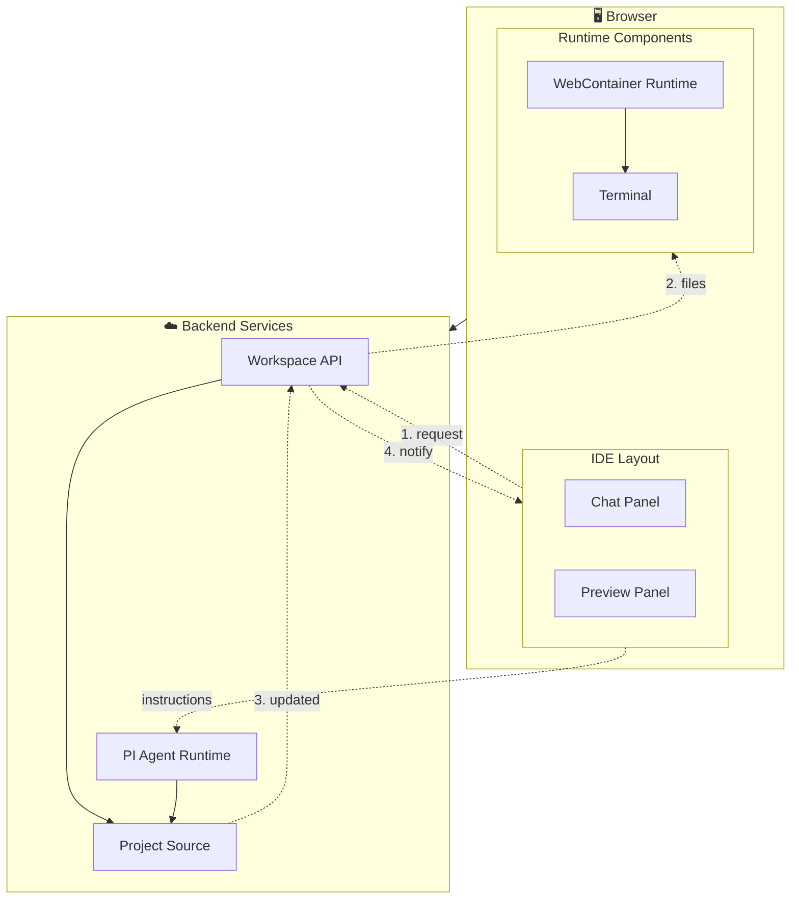
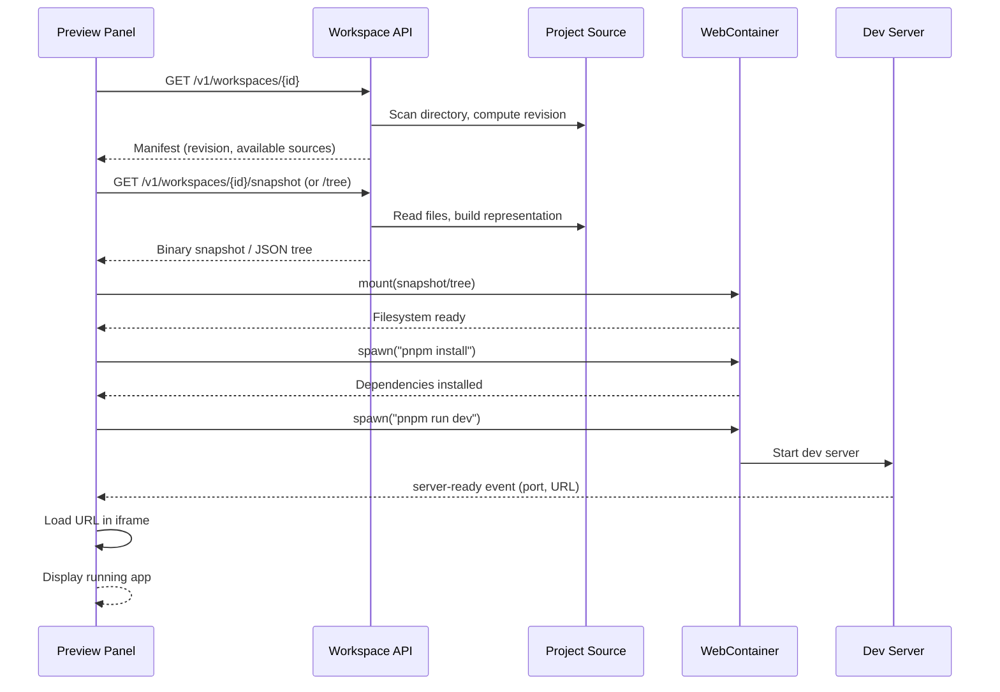
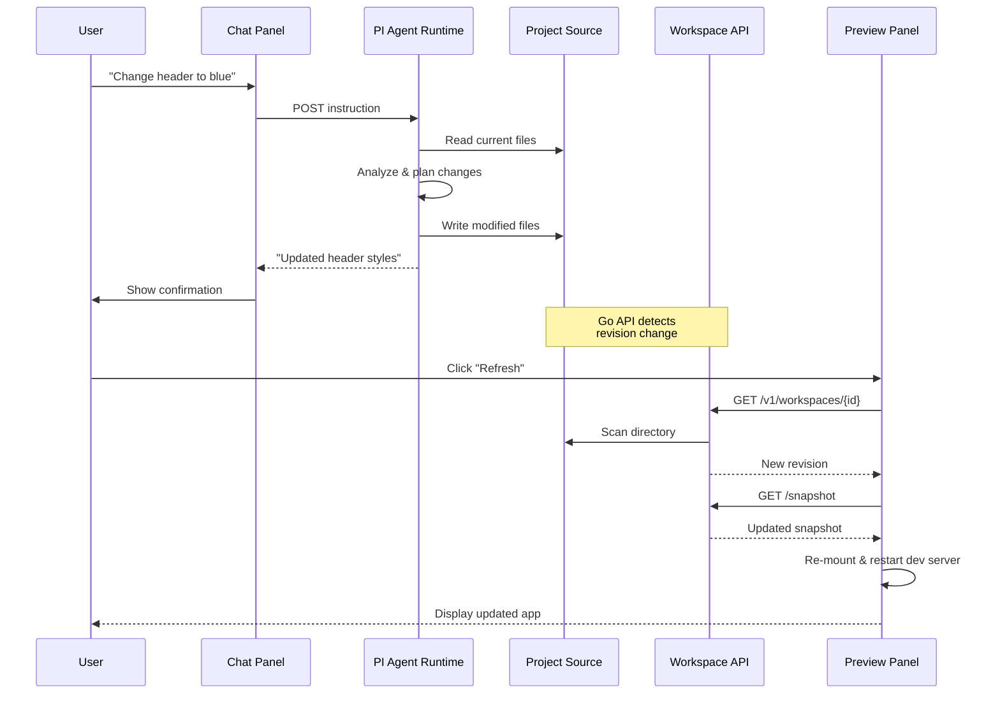

# PI Agent Web IDE

Browser-based IDE with a coding agent (PI) on the left and a live WebContainer preview on the right.

## Architecture

## Component Responsibilities

| Component | Role | Location |
|-----------|------|----------|
| **Chat Panel** | User interface for PI agent interaction | Left side (1/3 width) |
| **Preview Panel** | Displays the running application | Right side (2/3 width) |
| **WebContainer Runtime** | Executes the project in a sandboxed browser environment | Client-side |
| **Terminal** | Interactive shell inside the container | Bottom of Preview Panel |
| **Workspace API** | Serves project files and tracks versions | Backend service |
| **PI Agent Runtime** | Processes user instructions and modifies code | Backend service |
| **Project Source** | The actual application being developed | File system |

## Workspace API Execution Flow

When the Preview Panel mounts a workspace, the following sequence occurs:

## PI Agent Modification Flow

## Key Characteristics

- **Separation of Concerns** — UI, runtime, and backend services are independently deployable
- **Eventual Consistency** — Code changes propagate from agent → source → API → preview on explicit refresh
- **Sandboxed Execution** — User code runs in an isolated WebContainer, never on the host
- **Stateless Backend** — Workspace API serves files; no session state persists server-side
- **Resizable Layout** — Both vertical (left/right) and horizontal (preview/terminal) dividers are draggable

## Technology Stack

| Layer | Technology |
|-------|------------|
| IDE Shell | Next.js 16 (App Router), React 19, Tailwind CSS v4 |
| Container Runtime | @webcontainer/api (WASM-based Node.js) |
| Terminal Emulator | xterm.js |
| Workspace API | Go 1.26 (custom binary) |
| Agent Runtime | pi CLI (Node.js, litellm → kimi-k3) |
| Project Template | Next.js 15 (Pages Router), React 19, sql.js (SQLite WASM) |
