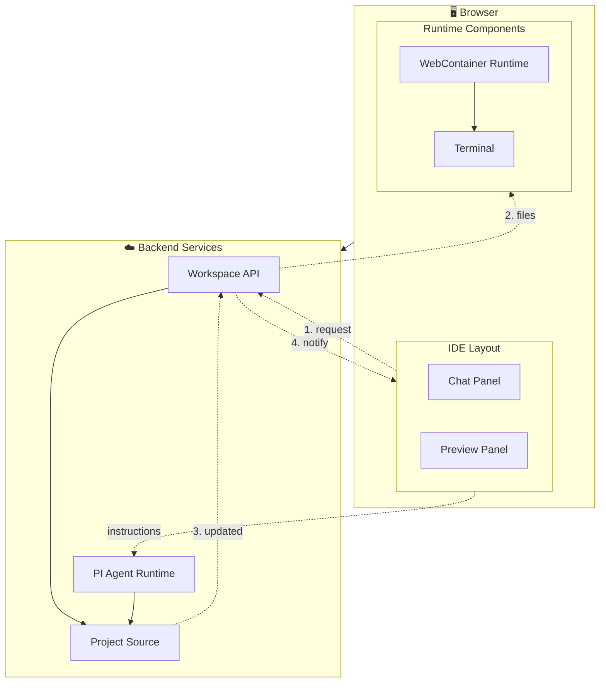
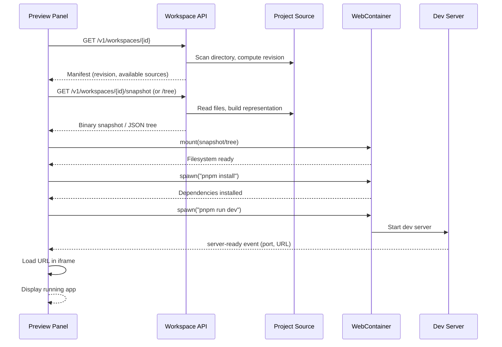
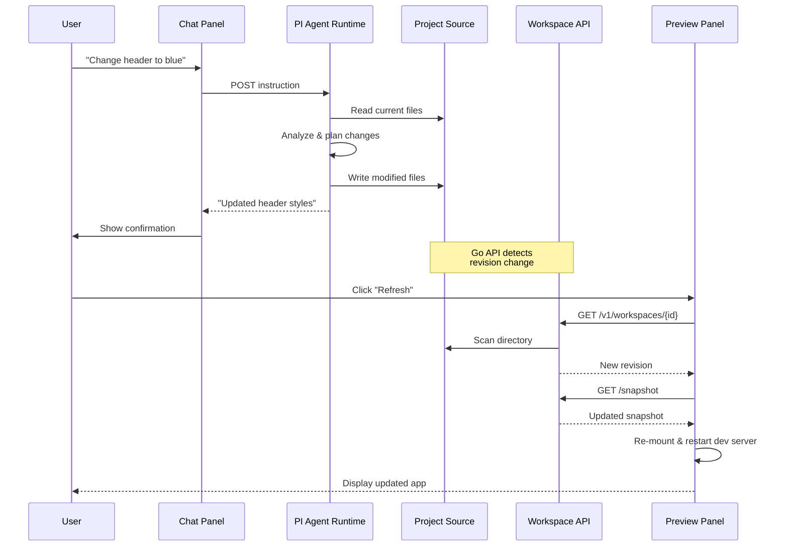

# PI Agent Web IDE

Browser-based IDE with a coding agent (PI) on the left and a live WebContainer preview on the right.

## 中文界面与字体

平台仅面向中文用户，不配置多语言路由、语言切换或国际化依赖。
首页、工作区、聊天、编辑器、预览及登录提示使用简体中文；代码、文件名、用户内容、
终端进程输出和必要的技术名称保持原样。

首页展示商业咨询 QQ 群号 `1135649093` 和微信号 `HyperDevOps`。可通过服务端环境变量
`COMMERCIAL_QQ_GROUP_URL` 配置 `https://qm.qq.com/…` 或 `https://jq.qq.com/…` 的官方入群链接；
未配置或地址不合法时仅显示群号和微信号，不生成虚假链接。Kubernetes 部署需要把该变量加入 Deployment。

字体统一在 `app/globals.css` 的 `:root` 中配置：
- `--font-chinese-ui`：中文界面字体，优先使用系统已安装的苹方、微软雅黑等。
- `--font-code`：代码与终端的等宽字体及中文回退字体。

不下载远程中文字体。Monaco 编辑器的官方中文语言包和相关资源由
`scripts/prepare-monaco.mjs` 从本机依赖复制到 `public/monaco`，随 `dev` / `build`
自动准备，按需从本站加载，不使用 CDN。生成目录已忽略；若其中混入手动修改或陌生文件，
脚本会拒绝覆盖，请先检查内容，不要直接删除。

## WebContainer 依赖安装

WebContainer 启动 shell、依赖安装和开发服务器进程时，通过进程环境变量
`npm_config_registry=https://registry.npmmirror.com/` 设置 npm 和 pnpm 的默认仓库；
这些进程启动的子进程也会继承该设置。不修改宿主机或工作区的 `.npmrc` 和锁文件。
scoped 仓库、锁文件中固定的下载地址或另行启动的进程可能仍使用其他来源；该设置
也不改变 StackBlitz 托管的 WebContainer 运行时。

## 将本地密钥写入 Kubernetes

先准备好项目 `.env.local` 中的 `PI_LITELLM_BASE_URL`、`PI_LITELLM_API_KEY`、
`AUTH_CLIENT_SECRET`、`AUTH_SESSION_KEY` 四个变量，再执行：

```bash
# 只做服务端校验，不写入 Secret
node scripts/sync-k8s-secret.mjs --context default --dry-run
# 首次创建 agents/webcontainer-env
node scripts/sync-k8s-secret.mjs --context default
# 后续仅更新这四个变量，保留 Secret 内的其他字段
node scripts/sync-k8s-secret.mjs --context default --update
```

脚本使用 Node.js 22 的环境文件解析能力，仅读取指定文件中的白名单变量，
不会继承同名进程环境变量、上传整个 `.env.local`、打印密钥值或生成含密钥的 YAML。
默认使用当前 context，可显式指定 `--context`、`--namespace`、`--name`、`--env-file`。
目标 Secret 已存在时，必须显式传入 `--update`；更新采用带 resourceVersion 的合并补丁。
macOS / Linux 环境需要事先安装并配置 kubectl。请先确认 context 是预期集群。

首次缺少 Secret 的 Pod 会在创建 Secret 后自动重试启动。更新已有运行中 Pod 的环境变量后，
需要手动重启并等待就绪：

```bash
kubectl -n agents rollout restart deployment/webcontainer
kubectl -n agents rollout status deployment/webcontainer
```

仅在本机访问集群 Service：先确认并停止占用本机 3000 端口的应用，不要关闭整个 Docker 服务。

```bash
kubectl -n agents port-forward --address localhost svc/webcontainer 3000:3000
# 打开 http://localhost:3000/（同时监听 IPv4 和 IPv6 回环地址）
```

保持端口转发进程运行。它不会创建公网入口，也不会改变生产环境的 Authing HTTPS 回调。

## Authing single sign-on

The app uses OIDC authorization code + PKCE S256, state and nonce. ID tokens
are validated against the issuer's JWKS with **RS256**. Configure this signing
algorithm in the Authing application. Access tokens and client secrets remain
server-side; the encrypted ID token is used only as the standard `id_token_hint`
when redirecting to Authing logout. No tokens are stored in browser localStorage.
Browser sessions use Secure, HttpOnly, SameSite=Lax cookies. Sessions are
revocable, persist in SQLite, and expire at the earlier of eight hours or ID-token
expiry. Refresh tokens are not requested; sign in again after expiry.

Configure these exact URLs in Authing:

| Setting | URL |
| --- | --- |
| Login callback | `https://vibe-coding.host/auth/callback` |
| Logout callback | `https://vibe-coding.host/` |
| Login initiation | `https://vibe-coding.host/auth/login` |

Set `AUTH_ORIGIN`, `AUTH_ISSUER`, and `AUTH_CLIENT_ID` as shown in `.env.example`.
Set `AUTH_CLIENT_SECRET` and `AUTH_SESSION_KEY` only in the server environment
(or the existing `agents/webcontainer-env` Kubernetes Secret). Generate the latter
with `openssl rand -hex 32`. Never bake secrets into Docker build arguments or
client bundles. Rotate any secret disclosed in chat or logs. Keep the session key
stable across restarts; changing it prevents provider logout for old sessions.

The registered HTTPS origin must reach the application through a trusted ingress
or equivalent TLS endpoint. The supplied ClusterIP Service does **not** create
DNS, HTTPS ingress, certificates, or Authing application configuration. Local HTTP
port-forwarding alone cannot complete this production callback flow.

### Local SSO with the production hostname

Local development uses the same Authing SSO as production, including when
`PI_RUNTIME_MODE=local`. To test `https://vibe-coding.host` against the local
application:

1. Add `127.0.0.1 vibe-coding.host` to your hosts file. This affects only name
   resolution; it does not provide HTTPS or forward port 443.
2. Obtain a certificate and private key for `vibe-coding.host` that your browser
   trusts (for example, a locally trusted mkcert certificate). Place them at
   `.data/tls/tls.crt` and `.data/tls/tls.key`. This directory is ignored by Git
   and excluded from Docker build contexts; keep the private key restricted to
   your user. Alternatively, set `ENVOY_TLS_CERT` and `ENVOY_TLS_KEY` to absolute
   paths outside the repository. The files are mounted read-only, and Docker Compose
   will fail if they are missing.
3. Set `AUTH_ORIGIN=https://vibe-coding.host`, `AUTH_CLIENT_SECRET`, and
   `AUTH_SESSION_KEY` in `.env.local`, and ensure the Authing URLs above are
   registered. Set `PI_RUNTIME_MODE=local`, run `pnpm dev`, and keep it running.
   The Next.js development server binds to `127.0.0.1:3000`.
4. Start Envoy with Docker Desktop:

   ```bash
   docker compose -f deploy/compose.envoy.yaml up -d
   # Open https://vibe-coding.host
   # When finished:
   docker compose -f deploy/compose.envoy.yaml down
   ```

   Envoy listens on `127.0.0.1:443` and forwards to the host's port 3000. It
   preserves the Host and HTTPS scheme, supports WebSocket upgrades, and keeps
   event streams open. Port 443 must be free before starting. For a proxy-only
   connectivity test, set `ENVOY_HTTPS_PORT` to an unused port; the alternate
   origin is not the registered Authing callback and will not complete SSO.
   Restart Envoy after replacing the certificate or key.

   If Envoy cannot reach the app, check that Docker Desktop can reach the
   loopback-only Next.js server using `host.docker.internal`:

   ```bash
   docker run --rm curlimages/curl:latest --noproxy '*' --connect-timeout 5 http://host.docker.internal:3000/api/healthz
   ```

   Host-loopback reachability can vary by Docker setup. Do not rebind the local
   development server to a public interface as a workaround.

The hosts entry redirects this hostname away from production; remove it after
local testing. Use a separate browser profile: local and production share an
origin and therefore cookies, and SSO logout may affect the production session.
Do not expose the proxy or development server to the network: the local agent can
execute commands on this host. Workspaces created by the former local administrator
remain in SQLite but are not automatically assigned to an Authing user.

For local HTTP debugging of a production container, `AUTH_ALLOW_HTTP_LOCALHOST`
is an explicit opt-in; the supplied production deployment leaves it disabled and
uses HTTPS. Remote HTTP remains rejected.

Every workspace API checks the signed-in owner before filesystem or agent
operations. Missing sessions return JSON 401, and non-owned workspaces return 404.
Mutation requests require an Origin matching `AUTH_ORIGIN`. Project IDs are never
recycled, even after deletion, so a new owner cannot inherit an old agent session
or CR. Health checks remain public. The unused `/api/chat` CLI endpoint returns 410 for owned workspaces:
running arbitrary coding commands inside the web server would expose server
credentials and other users' files. Use per-workspace PiWorker RPC instead.
Snapshots are served only through authenticated APIs; `/snapshots/*` is blocked.

### Existing project ownership

Migration preserves existing rows and files but leaves historical projects
unowned and invisible. Never automatically assign them to the first login.
After the intended owner has logged in, stop the app, back up the SQLite database,
and assign only explicitly selected projects using the user's verified **issuer
and subject**, not an email address. For example, in a SQLite administration
session, using bound parameters rather than interpolated user input:

```sql
SELECT id, issuer, subject, name FROM auth_users;
SELECT id, name FROM workspaces WHERE owner_id IS NULL;
UPDATE workspaces SET owner_id = (
  SELECT id FROM auth_users WHERE issuer = :issuer AND subject = :subject
) WHERE id = :workspace_id AND owner_id IS NULL
  AND EXISTS (SELECT 1 FROM auth_users WHERE issuer = :issuer AND subject = :subject);
```

Review the affected-row count before restarting. Session and ownership tables
must use the local SQLite PVC, not the NFS workspace PVC. Application ownership
checks are not a container isolation boundary: PiWorker pods must mount only their
own workspace and must not receive the web server's credentials or privileged
Kubernetes permissions. Verify the per-workspace NFS/PVC mount isolation before
enabling agents for untrusted users; Service RPC transport alone does not provide
filesystem isolation.

### 附件及工作区大小限制

在 `.env.local`（本地）或 `deploy/deployment.yaml`（Kubernetes）中配置：

- `WORKSPACE_MAX_FILE_BYTES`：单个文件上限，默认 `10485760` 字节（10 MiB）。
- `WORKSPACE_MAX_TOTAL_BYTES`：工作区所有非忽略文件的总大小上限，默认 `52428800` 字节（50 MiB），必须不小于单文件上限。

单位均为字节，1 MiB = 1,048,576 字节；附件以原始二进制上传，不会按 UTF-8 重编码。工作区总大小也包含代码和 `.attachments/`。上传附件时会检查总上限，避免附件使工作区无法生成文件树或快照；工作区中的 agent 进程可能同时改动文件，因此应用内检查不是跨进程的存储配额。快照生成另有 100 MiB 的输出上限，调大工作区总上限时也要考虑此限制及服务内存。

应用环境变量只控制应用，不控制上游网关。`deploy/ingress.yaml` 使用 Traefik，当前清单没有设置请求体大小上限；如果 413 响应来自网关，请检查实际部署的 Traefik middleware、负载均衡器和其他前置代理，将它们的请求体上限至少设为单文件上限。修改环境变量后须重启本地服务或更新 Kubernetes Deployment，并确保浏览器加载新版前端。

### Agent 运行模式（local / prod）

项目通过显式的 `PI_RUNTIME_MODE` 只保留两种运行模式（必须配置，不自动猜测）：

- **`PI_RUNTIME_MODE=local`**（本地开发）：在服务端启动本机
  `pi --mode rpc --provider litellm`，工作目录为该工作区在本机磁盘上的目录，直接
  读写本地文件。页面提供新建和恢复上次会话图标；仅可恢复最后修改时间在过去
  24 小时内的会话，不提供历史列表。启动时自动恢复符合条件的最近一次会话，否则
  开始新会话。session 默认保存在宿主机用户的 `~/.pi/agent/sessions/` 对应 cwd
  目录，可用 `PI_LOCAL_SESSION_ROOT` 覆盖根目录。只恢复 session 头部 cwd 与当前
  工作区一致的记录，不会恢复其他项目。旧版本 session 可能被 Pi 迁移，自动恢复会
  跳过旧格式；手动恢复需确认。删除工作区不会删除宿主机上的 Pi session 文件；
  已有本机模式使用 `--no-session` 产生的聊天未曾持久化，无法追溯恢复。

  应用自动为本机 Pi 创建临时隔离配置并注册 LiteLLM provider。API key 写入 0600
  临时文件，不出现在命令行或常规环境变量中；进程退出时清理配置和密钥。
  `PI_BIN` 可指定二进制路径（默认 `pi`）。`NODE_ENV=production` 时该模式被拒绝——
  生产服务器绝不运行本地编码 CLI。

  恢复依赖 Pi 已写入的 session：首次 assistant 消息之前 Pi 可能还未创建文件；刚新建
  的空会话若重新打开，可能自动恢复之前已保存的会话。强制退出也可能丢失尚未落盘的
  消息和流式内容。断线后的未知请求不会自动重放。不要同时用独立 Pi 进程写入同一个
  工作区 session。

- **`PI_RUNTIME_MODE=prod`**（线上部署，`deploy/deployment.yaml` 已设置）：webcontainer 后端
  使用每个 PiWorker 的 `status.serviceName`，通过
  `ws://<serviceName>.<PI_NAMESPACE>.svc:8080/v1/rpc` 连接 agent，不使用 Ingress
  endpoint，也没有 endpoint 模式或 TLS 转发配置。Bearer token 认证和项目归属检查
  保持不变，token 不交给浏览器。PiWorker 的持久会话恢复尚未实现。

操作详情展示 Pi 请求的命令及参数、可验证的工作区内路径和部分数字信息；不单独展示
命令输出、文件正文、搜索工具的搜索词或修改前后的内容。命令本身可能包含搜索词、
凭据、私有路径或内嵌文件片段，展示时不会保证自动脱敏，请注意屏幕共享。本地会话
历史对该工作区的授权页面共享；详细文本按字节限长，超出会提示，控制字符显示为
转义形式。

prod 连接链路为：浏览器 → webcontainer 后端 → PiWorker ClusterIP Service → agent。
`kubectl port-forward svc/webcontainer 3000:3000` 只转发 Web UI；RPC 仍从集群内的
webcontainer Pod 发出。

当前 PiWorker operator 仍会创建 Ingress 资源；本应用不使用其 RPC 数据路径，
也不修改 operator/CRD，不删除其管理的资源。

### 离开工作区后的 agent 回收

每个工作区页面使用独立的 client lease。站内导航、刷新或关闭标签页时，页面会
释放自己的 lease；同一工作区还有其他页面使用时不会误停 agent。最后一个页面
释放后，服务端关闭 RPC 并请求删除应用管理的 PiWorker，由 operator 回收其子资源。
Kubernetes finalizer 和 Pod 正常终止可能使资源稍后才完全消失。

关页通知属于浏览器 best-effort 行为。若通知丢失，服务端在检测到 SSE 断开后保留
30 秒重连宽限，之后即使 agent 仍在生成回复也会回收；仅切换标签页不会触发停止。
成功启动但没有建立 SSE 的页面也会过期。已释放的页面不能通过 SSE 自动重连重新创建 agent。

生命周期状态和操作串行化在当前单个 Node 进程内维护，部署必须保持单副本；本机制
不替代服务器进程崩溃后的持久资源回收控制器。页面请求中的 clientId 不是认证凭据，
所有接口仍检查会话、项目归属与变更 Origin。

Run `pnpm test`, `pnpm exec tsc --noEmit`, and `pnpm lint`. Tests use a temporary
SQLite database and a mock OIDC provider with real RSA signatures; no real client
secret or identity-provider account is required. A real browser login/logout
against the configured HTTPS site remains an explicit deployment acceptance step.

## Architecture




## Component Responsibilities

| Component | Role | Location |
|-----------|------|----------|
| **Chat Panel** | User interface for PI agent interaction | Left side (1/3 width) |
| **Preview Panel** | Displays the running application | Right side (2/3 width) |
| **WebContainer Runtime** | Executes the project in a sandboxed browser environment | Client-side |
| **Terminal** | Interactive shell inside the container | Bottom of Preview Panel |
| **Workspace API** | Serves project files and tracks versions | Backend service |
| **PI Agent Runtime** | Processes user instructions and modifies code | Backend service |
| **Project Source** | The actual application being developed | File system |

## Workspace API Execution Flow

When the Preview Panel mounts a workspace, the following sequence occurs:



## PI Agent Modification Flow



## Key Characteristics

- **Separation of Concerns** — UI, runtime, and backend services are independently deployable
- **Eventual Consistency** — Code changes propagate from agent → source → API → preview on explicit refresh
- **Sandboxed Execution** — User code runs in an isolated WebContainer, never on the host
- **Stateless Backend** — Workspace API serves files; no session state persists server-side
- **Resizable Layout** — Both vertical (left/right) and horizontal (preview/terminal) dividers are draggable

## Technology Stack

| Layer | Technology |
|-------|------------|
| IDE Shell | Next.js 16 (App Router), React 19, Tailwind CSS v4 |
| Container Runtime | @webcontainer/api (WASM-based Node.js) |
| Terminal Emulator | xterm.js |
| Workspace API | Go 1.26 (custom binary) |
| Agent Runtime | pi CLI (Node.js, litellm → kimi-k3) |
| Project Template | Next.js 15 (Pages Router), React 19, sql.js (SQLite WASM) |
