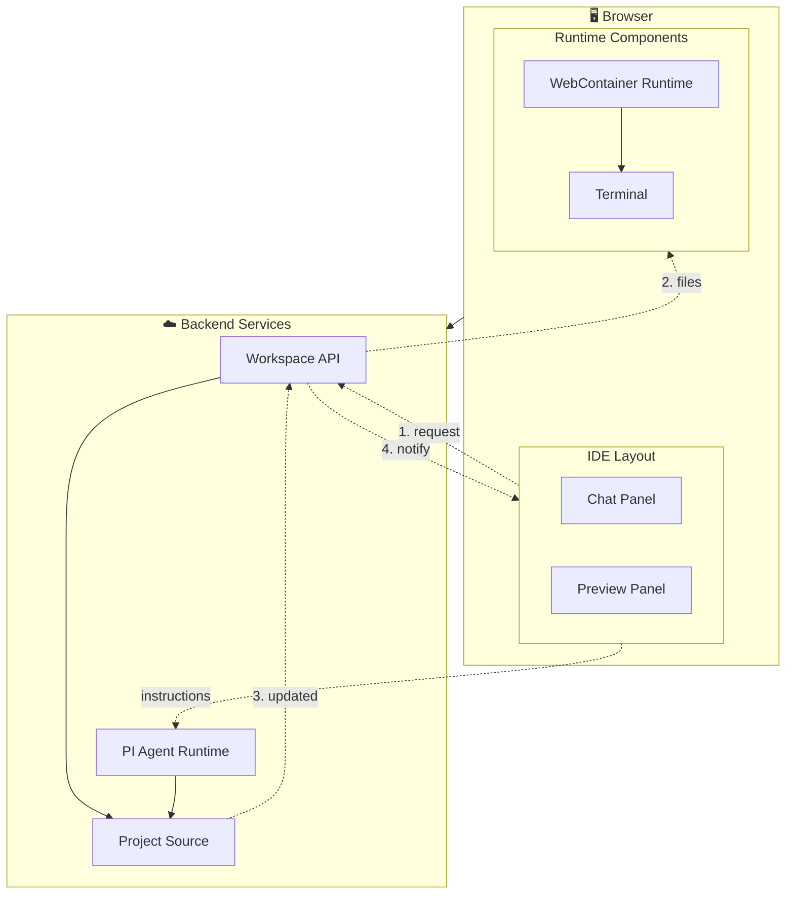
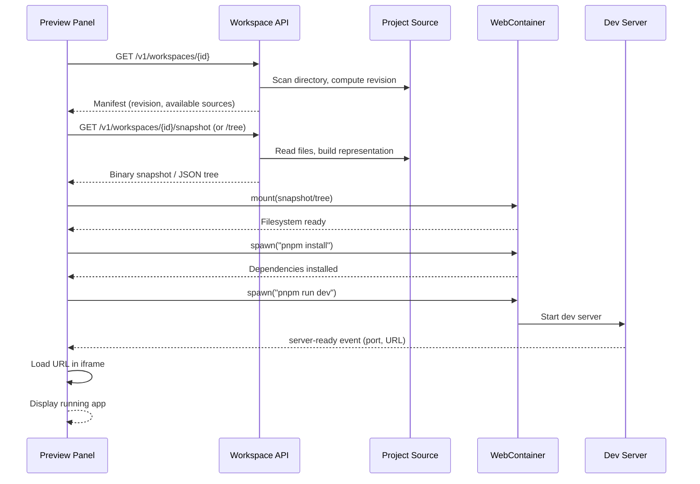
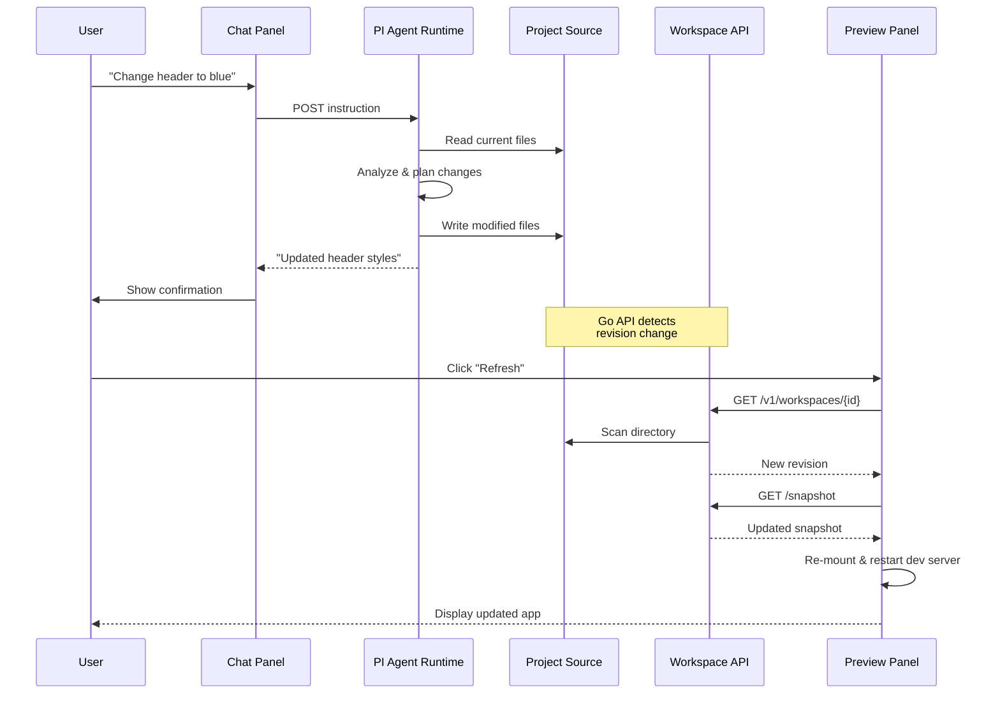

# PI Agent Web IDE

Browser-based IDE with a coding agent (PI) on the left and a live WebContainer preview on the right.

## 中文界面与字体

平台仅面向中文用户，不配置多语言路由、语言切换或国际化依赖。
首页、工作区、聊天、编辑器、预览及登录提示使用简体中文；代码、文件名、用户内容、
终端进程输出和必要的技术名称保持原样。

字体统一在 `app/globals.css` 的 `:root` 中配置：
- `--font-chinese-ui`：中文界面字体，优先使用系统已安装的苹方、微软雅黑等。
- `--font-code`：代码与终端的等宽字体及中文回退字体。

不下载远程中文字体。Monaco 编辑器的官方中文语言包和相关资源由
`scripts/prepare-monaco.mjs` 从本机依赖复制到 `public/monaco`，随 `dev` / `build`
自动准备，按需从本站加载，不使用 CDN。生成目录已忽略；若其中混入手动修改或陌生文件，
脚本会拒绝覆盖，请先检查内容，不要直接删除。

## Authing single sign-on

The app uses OIDC authorization code + PKCE S256, state and nonce. ID tokens
are validated against the issuer's JWKS with **RS256**. Configure this signing
algorithm in the Authing application. Access tokens and client secrets remain
server-side; the encrypted ID token is used only as the standard `id_token_hint`
when redirecting to Authing logout. No tokens are stored in browser localStorage.
Browser sessions use Secure, HttpOnly, SameSite=Lax cookies. Sessions are
revocable, persist in SQLite, and expire at the earlier of eight hours or ID-token
expiry. Refresh tokens are not requested; sign in again after expiry.

Configure these exact URLs in Authing:

| Setting | URL |
| --- | --- |
| Login callback | `https://console.vibe-coding.host/auth/callback` |
| Logout callback | `https://console.vibe-coding.host/` |
| Login initiation | `https://console.vibe-coding.host/auth/login` |

Set `AUTH_ORIGIN`, `AUTH_ISSUER`, and `AUTH_CLIENT_ID` as shown in `.env.example`.
Set `AUTH_CLIENT_SECRET` and `AUTH_SESSION_KEY` only in the server environment
(or the existing `agents/webcontainer-env` Kubernetes Secret). Generate the latter
with `openssl rand -hex 32`. Never bake secrets into Docker build arguments or
client bundles. Rotate any secret disclosed in chat or logs. Keep the session key
stable across restarts; changing it prevents provider logout for old sessions.

The registered HTTPS origin must reach the application through a trusted ingress
or equivalent TLS endpoint. The supplied ClusterIP Service does **not** create
DNS, HTTPS ingress, certificates, or Authing application configuration. Local HTTP
port-forwarding alone cannot complete this production callback flow. For local
`npm run dev` / `pnpm dev`, set `AUTH_ORIGIN=http://localhost:3000` and add
`http://localhost:3000/auth/callback` to Authing's login callback allowlist and
`http://localhost:3000/` to its logout callback allowlist. Local HTTP uses separate
non-Secure, HttpOnly cookies without the `__Host-` prefix. This exception is limited
to loopback hosts outside production; `npm start` still requires HTTPS. Always
use `localhost` consistently rather than switching between it and `127.0.0.1`.

Every workspace API checks the signed-in owner before filesystem or agent
operations. Missing sessions return JSON 401, and non-owned workspaces return 404.
Mutation requests require an Origin matching `AUTH_ORIGIN`. Project IDs are never
recycled, even after deletion, so a new owner cannot inherit an old agent session
or CR. Health checks remain public. The unused `/api/chat` CLI endpoint returns 410 for owned workspaces:
running arbitrary coding commands inside the web server would expose server
credentials and other users' files. Use per-workspace PiWorker RPC instead.
Snapshots are served only through authenticated APIs; `/snapshots/*` is blocked.

### Existing project ownership

Migration preserves existing rows and files but leaves historical projects
unowned and invisible. Never automatically assign them to the first login.
After the intended owner has logged in, stop the app, back up the SQLite database,
and assign only explicitly selected projects using the user's verified **issuer
and subject**, not an email address. For example, in a SQLite administration
session, using bound parameters rather than interpolated user input:

```sql
SELECT id, issuer, subject, name FROM auth_users;
SELECT id, name FROM workspaces WHERE owner_id IS NULL;
UPDATE workspaces SET owner_id = (
  SELECT id FROM auth_users WHERE issuer = :issuer AND subject = :subject
) WHERE id = :workspace_id AND owner_id IS NULL
  AND EXISTS (SELECT 1 FROM auth_users WHERE issuer = :issuer AND subject = :subject);
```

Review the affected-row count before restarting. Session and ownership tables
must use the local SQLite PVC, not the NFS workspace PVC. Application ownership
checks are not a container isolation boundary: PiWorker pods must mount only their
own workspace and must not receive the web server's credentials or privileged
Kubernetes permissions. The separately configured Service RPC/PVC-subPath work
is still required before enabling agents for untrusted users.

Run `pnpm test`, `pnpm exec tsc --noEmit`, and `pnpm lint`. Tests use a temporary
SQLite database and a mock OIDC provider with real RSA signatures; no real client
secret or identity-provider account is required. A real browser login/logout
against the configured HTTPS site remains an explicit deployment acceptance step.

## Architecture




## Component Responsibilities

| Component | Role | Location |
|-----------|------|----------|
| **Chat Panel** | User interface for PI agent interaction | Left side (1/3 width) |
| **Preview Panel** | Displays the running application | Right side (2/3 width) |
| **WebContainer Runtime** | Executes the project in a sandboxed browser environment | Client-side |
| **Terminal** | Interactive shell inside the container | Bottom of Preview Panel |
| **Workspace API** | Serves project files and tracks versions | Backend service |
| **PI Agent Runtime** | Processes user instructions and modifies code | Backend service |
| **Project Source** | The actual application being developed | File system |

## Workspace API Execution Flow

When the Preview Panel mounts a workspace, the following sequence occurs:



## PI Agent Modification Flow



## Key Characteristics

- **Separation of Concerns** — UI, runtime, and backend services are independently deployable
- **Eventual Consistency** — Code changes propagate from agent → source → API → preview on explicit refresh
- **Sandboxed Execution** — User code runs in an isolated WebContainer, never on the host
- **Stateless Backend** — Workspace API serves files; no session state persists server-side
- **Resizable Layout** — Both vertical (left/right) and horizontal (preview/terminal) dividers are draggable

## Technology Stack

| Layer | Technology |
|-------|------------|
| IDE Shell | Next.js 16 (App Router), React 19, Tailwind CSS v4 |
| Container Runtime | @webcontainer/api (WASM-based Node.js) |
| Terminal Emulator | xterm.js |
| Workspace API | Go 1.26 (custom binary) |
| Agent Runtime | pi CLI (Node.js, litellm → kimi-k3) |
| Project Template | Next.js 15 (Pages Router), React 19, sql.js (SQLite WASM) |
